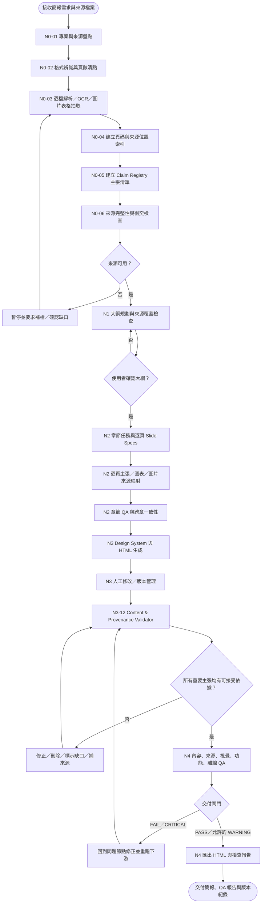

# AGENTS.md — 地球的奧秘 (Mysteries of the Earth) LLM Wiki Schema

本規範定義了《地球的奧秘》課程個人知識庫（Personal Knowledge Base）的架構、維護原則與工作流。
本系統落實 **Andrej Karpathy 的 LLM Wiki 構想**：Wiki 是一套持久、具複利增長效應的 Markdown 知識網絡，由 LLM Agent 全權負責編寫、跨篇交互參照、矛盾校對與版本維護；使用者專注於提供原始材料、提問、探索與方向指導。

---

## 1. 系統架構（Three Layers）

```text
earth-secrets-wiki/
├── AGENTS.md                  # 【Schema 層】系統核心規範與 LLM 維護規則（本檔案）
├── index.md                   # 【導覽層】內容總目錄，提供主題、概念、實體之清單與一句話摘要
├── log.md                     # 【日誌層】時間軸流水帳，記錄所有匯入、重大問答回寫與健檢
├── raw/                       # 【原始資料層 (Immutable)】只讀不改，真相之源
│   ├── slides/                # 使用者提供的原始課程投影片（.ppt / .pptx；以實際檔案清單為準，不預設份數）
│   └── assets/                # 投影片原始附加檔案或備用資產
├── wiki/                      # 【知識庫層】LLM 完全掌控與維護的 Markdown 檔案集
│   ├── sources/               # 各講次/投影片之結構化摘要（如 S01-課程介紹.md、S02-星球的誕生.md）
│   ├── concepts/              # 核心地質作用、物理化學機制（如 板塊構造、元素分異作用、岩石循環）
│   ├── entities/              # 具體物質、地質時代、天體結構（如 類地行星、玄武岩、中洋脊、寒武紀）
│   ├── theories/              # 重要科學假說、理論模型（如 星雲假說、大陸漂移說、稀有地球假說）
│   └── syntheses/             # 跨講次綜合分析、比較矩陣、大歷史時間軸（持久化高價值問答成果）
├── assets/                    # 精選提取自投影片之關鍵示意圖、地質剖面圖與外觀圖
└── tools/                     # 輔助維護腳本（如投影片純文字與圖片抽取腳本 extract.ps1）
```

---

## 2. 編輯與格式慣例（Conventions）

1. **雙向鏈結（Wikilinks）**：
   - 頁面間參照統一使用 `[[頁面檔名|顯示名稱]]` 或 `[[頁面檔名]]`（支援 Obsidian 與標準 Markdown 檢視器）。
   - 凡提及 `wiki/` 內已有或應有之重要實體、機制、學說，必須建立雙向鏈結。
2. **語系與專有名詞**：
   - 全篇一律採用**正體中文**撰寫。
   - 所有地科學術名詞、天體、地層時代、礦物岩石名稱首次出現時，**必須標註繁中（英文）**，例如：
     - `太陽元素分異作用 (Solar Elemental Differentiation)`
     - `類地行星 (Terrestrial Planets)`
     - `星雲假說 (Nebular Hypothesis)`
3. **視覺化與圖表**：
   - **優先使用 Mermaid**：凡涉及流程、因果關係、演化時序、地層層級，一律以 `mermaid` 繪製流程圖（`graph TD`/`graph LR`）或時間軸（`timeline`）。
   - **投影片圖片引用**：若投影片包含重要真實照片或精密地質構造剖面圖，解開並複製至 `assets/`，在 Markdown 內以 `![[檔名.png]]` 或 `` 引用。
4. **Frontmatter 元資料**：
   每個 wiki 頁面頂部應包含 YAML Frontmatter：
   ```yaml
   ---
   title: 頁面繁中名稱 (English Name)
   type: source | concept | entity | theory | synthesis
   tags: [earth-science, geology, astronomy]
   updated: YYYY-MM-DD
   sources: ["[[S02-星球的誕生]]"]
   ---
   ```

---

## 3. 核心運作流程（Operations）

### A. 匯入流程（Ingest Workflow）
當使用者上傳或指示處理 `raw/slides/` 中的投影片時：
1. **抽取內容**：優先執行 `powershell -File tools/extract.ps1 -FilePath <投影片路徑>`；若格式不支援或抽取不完整，改用相容工具轉檔／解析，並檢查每頁文字、圖片、表格及圖表。必須記錄抽取工具、頁數、失敗頁與人工補查狀態。
2. **建立講次摘要**：在 `wiki/sources/` 建立 `Sxx-主題名稱.md`，內容包含：
   - 投影片核心主旨與教授講述脈絡
   - 核心要點（分投影片重點整理）
   - 本講引申出的關鍵概念清單（雙向鏈結至 `wiki/concepts/`、`wiki/entities/` 等）
3. **更新知識庫網絡**：
   - 檢查本講提到的概念與實體；若該頁面尚未存在，則在相應目錄新建，並填入定義、機制、關聯。
   - 若頁面已存在，將新資訊、不同角度或互補內容整合進既有頁面（附來源引用）。
   - 一次匯入通常會更新或新建 5～15 個 wiki 頁面。
4. **維護索引與日誌**：
   - 在 `index.md` 相應分類下加入新頁面與一句話摘要。
   - 在 `log.md` 追寫一筆記錄：
     `## [YYYY-MM-DD] ingest | Sxx-主題名稱 (更新 N 篇頁面)`

### B. 查詢與回寫流程（Query & Compound Workflow）
1. **查閱檢索**：先閱讀 `index.md` 定位相關概念與來源頁面，深入讀取相應頁面後彙整回答。
2. **回答規範**：解答需綜合多篇筆記，並清楚附上 `[[來源筆記]]` 引用。
3. **知識複利回寫**：若解答為深入的跨章節比較、因果機制推演、或體系化總結，主動詢問或自動將該分析成果整理為 Markdown 頁面收錄至 `wiki/syntheses/`，並更新 `index.md`。

### C. 知識健檢流程（Lint Workflow）
定期檢查知識庫健康度：
1. **排查孤兒頁面（Orphans）**：尋找沒有任何反向連結（Inbound Links）的筆記，並為其在適當主題頁面補上連結。
2. **矛盾與衝突檢測**：比對不同講次間是否有數據或說法衝突（如年齡定年差異、假說分歧），標註爭端並保留多元學說視角。
3. **缺漏補齊**：檢查已在文本中標註雙向連結但尚未實際建立檔案的紅色連結，並為核心概念補足定義。
4. 於 `log.md` 記錄：`## [YYYY-MM-DD] lint | 健檢通過 (修復 N 處)`。

---

## 4. 檔案命名與目錄指引
- 講次摘要：`wiki/sources/S01-課程介紹.md`、`wiki/sources/S02-星球的誕生.md` ...
- 概念機制：`wiki/concepts/太陽元素分異作用.md`、`wiki/concepts/板塊構造.md` ...
- 實體時代：`wiki/entities/類地行星.md`、`wiki/entities/太陽系.md`、`wiki/entities/玄武岩.md` ...
- 科學理論：`wiki/theories/星雲假說.md`、`wiki/theories/稀有地球假說.md` ...
- 綜合分析：`wiki/syntheses/地球歷史時間軸.md`、`wiki/syntheses/八大行星物理特性比較.md` ...


---

## 5. 簡報生成 Graph 工作流（PresentationGraph）

本節是本專案製作簡報時的強制流程。完整節點規格與資料結構另見 `docs/graph/Graph.md`；本節定義專案執行時不可省略的來源驗證與交付規則。**課程原始投影片、PDF、圖片及專案素材是唯一知識來源**；除非使用者明確允許外部研究，不得以模型既有知識補齊來源缺口。

### 5.1 核心原則

1. **來源先於生成**：必須先完成來源盤點、逐頁抽取及來源定位，再建立大綱或撰寫投影片。
2. **逐項主張可追溯**：每個具體事實、數值、年代、因果解釋、引用及圖表結論，都必須有可回查的 `source_ref`。不能只在整張投影片底部放一個籠統來源。
3. **忠實區分知識類型**：
   - `SOURCE_FACT`：來源直接明載。
   - `SUMMARY`：忠實摘要，不能增加來源沒有的條件或數值。
   - `INFERENCE`：由多項來源推導，必須標示「綜合推論」並列出全部依據。
   - `EXTERNAL_CONTEXT`：僅在使用者明確允許外部研究時使用，須標示外部來源，不得混充課程教材。
   - `MISSING`：來源未提供，應保留缺口，不得猜測。
4. **來源不等於事實正確性**：本流程能驗證「簡報是否忠於提供的教材」，不能單憑教材本身證明教材內容符合最新科學共識。兩者須分開報告。
5. **衝突不自行裁決**：不同講次或文件對同一數值／說法不一致時，建立 `CONFLICT` 記錄，保留各來源原文與頁碼，交由使用者決定；不得默默選擇或改寫。
6. **圖像也是來源**：重要資訊若只存在於示意圖、地圖、剖面圖或圖表，須檢視原始頁面影像並記錄圖號／頁碼；純文字抽取未出現，不代表圖像沒有資訊。
7. **大綱確認後鎖定**：未經使用者確認不得進入逐頁內容生成；重大章節變更需建立新版本並重新確認。
8. **內容與視覺分離**：內容資料、版面資料、設計資料分開管理；HTML 只負責呈現，不得自行增加事實。
9. **失敗即阻擋交付**：`Unsupported`、`Contradicted`、`Unverifiable` 的重要主張預設不得交付。例外放行必須由使用者明確授權、填寫理由並留存稽核紀錄。
10. **選擇性重跑**：來源或內容變更時，重跑受影響的來源映射、內容驗證、HTML 重建及下游 QA，不可只修畫面而保留過期驗證結果。

### 5.2 PresentationGraph 流程



### 5.3 節點與必備輸出

| 節點 | 工作內容 | 必備輸出／驗收條件 |
|---|---|---|
| N0-01 Source Intake | 盤點需求、檔案、版本、格式及授權 | `source_manifest`；記錄檔名、雜湊值、格式、大小、頁數 |
| N0-02 File Classifier | 辨識 PPT/PPTX/PDF/圖片/文件 | `file_inventory`；不得假設檔案數或頁數 |
| N0-03 Source Parser | 逐頁抽取文字、表格、圖片、圖表與備註 | `parsed_pages`；記錄解析成功／失敗頁 |
| N0-04 Provenance Mapper | 建立檔案、頁碼、投影片頁次、圖號與文字片段對應 | `source_refs`；每筆引用可回到原始位置 |
| N0-05 Claim Registry | 將簡報可能使用的事實拆成可驗證主張 | `claim_registry`；含 `claim_id`、主張文字、類型、來源、狀態 |
| N0-06 Source QA | 檢查缺頁、亂碼、抽取遺漏、來源衝突與可讀性 | `source_qa_report`；缺口明確列出 |
| N1 Outline Planner | 依來源建立章節架構及知識覆蓋表 | `outline_draft`、`coverage_matrix` |
| N1 Human Approval | 使用者確認章節範圍、順序及深度 | `approved_outline_version`；未確認不得進入 N2 |
| N2 Chapter Planner | 依章節分派任務並規劃頁數 | `chapter_tasks`、`slide_plan` |
| N2 Slide Writer | 產生逐頁內容規格 | `slide_specs`；每頁含標題、核心訊息、內容區塊、視覺描述、來源、前置知識及結論 |
| N2 Source Mapper | 將每個事實、數字、圖表結論連到來源 | `slide_claim_map`；不得以單一章節引用取代逐項映射 |
| N2 Chapter / Global QA | 檢查完整性、重複、矛盾、術語及來源覆蓋 | `chapter_qa_report`、`global_qa_report` |
| N3 Design & HTML | 建立設計系統、版型並輸出 HTML | `design_tokens`、`layout_specs`、`rendered_html` |
| N3 Editor & Versioning | 管理人工修改、快照、AI 重生成與衝突 | `change_log`、`version_history`；保留人工版本 |
| N3-12 Content Validator | 驗證所有新增／修改的內容及來源 | `Verified`、`Partially Supported`、`Unsupported`、`Contradicted`、`Unverifiable` |
| N4 Content QA | 檢查簡報與來源的一致性、數值、年代、術語及結論 | `content_qa_report` |
| N4 Provenance QA | 檢查逐項主張是否有精確來源定位 | `provenance_report` |
| N4 Visual / Functional / Offline QA | 以真實瀏覽器檢查桌機／手機寬度、文字溢位、重疊、上一頁／下一頁、Home／End、總覽開啟與指定頁跳轉、全螢幕、觸控及離線資源；若瀏覽器執行環境不可用，須標示未測項目，不得以靜態檢查冒充功能通過 | `visual_report`、`functional_report`、`offline_report`、`browser_test_log` |
| N4 Export & Delivery | 匯出 HTML、QA 報告及例外清單 | `final_html`、`qa_report`、`delivery_manifest` |

### 5.4 Claim Registry 與引用格式

每項可驗證主張至少記錄：

```yaml
claim_id: C-S03-001
claim: "地球年齡約為 46 億年"
claim_type: SOURCE_FACT
verification_status: Verified
source_refs:
  - file: "3_講義_固體地球的演化.pptx"
    slide: 8
    locator: "標題／文字區塊"
evidence_excerpt: "地球年齡 - 46億年"
notes: ""
```

引用必須精確到原始檔名及頁碼／投影片頁次。若來自圖表，補充圖號、圖說或區域描述；若 OCR 或文字抽取失敗，標示 `visual_review_required: true`，不可把未檢視的頁面當成已驗證。

### 5.5 驗證狀態與處置

| 狀態 | 定義 | 預設處置 |
|---|---|---|
| `Verified` | 來源直接支持主張，範圍與數值一致 | 可保留 |
| `Partially Supported` | 來源只支持部分內容，或簡報增加了來源未載明的細節 | 拆分主張、刪除未支持部分或補充來源 |
| `Unsupported` | 提供的來源中找不到依據 | 移除、改為明確標示的外部研究，或要求補來源 |
| `Contradicted` | 與一份或多份來源直接衝突 | 暫停並列出衝突，不得自行選邊 |
| `Unverifiable` | 來源缺頁、圖片無法辨識、文字抽取失敗或定位不足 | 補查原始頁面／要求補檔；未完成前阻擋重要主張 |

**不得把 `Partially Supported` 自動視為通過。** 一個段落含有多個事實時，必須拆成獨立主張逐項驗證。數值、年代、百分比、因果關係及專有名詞的驗證優先級最高。

### 5.6 大綱與逐頁規格

大綱必須包含章節目的、核心問題、來源覆蓋範圍、預計頁數及章節間依賴。使用者確認後鎖定版本。每張投影片至少具備：

- `slide_id`、`chapter_id`、`slide_title`
- `key_message`
- `content_blocks`（每個內容區塊附 `claim_ids`）
- `visual_type`、`visual_description`
- `source_refs`（精確到檔案及頁次）
- `previous_knowledge`
- `conclusion`
- `verification_status`

沒有來源的延伸知識不得混入一般內容區塊；若使用者允許外部研究，必須獨立標註 `EXTERNAL_CONTEXT` 並使用外部來源引用。

### 5.7 最終交付閘門與檢查報告

正式交付前必須輸出檢查報告，至少包含：

1. 來源清單、格式、頁數、抽取完整性及未能解析的頁面。
2. 逐頁來源對照表：簡報頁碼、對應教材檔案／頁次、驗證狀態。
3. `Unsupported`、`Partially Supported`、`Contradicted`、`Unverifiable` 主張清單及修正建議。
4. 跨來源衝突清單，保留原始說法與頁碼。
5. 內容 QA、來源追溯 QA、視覺 QA、功能 QA、離線 QA 結果；功能 QA 應保留瀏覽器操作紀錄與桌機／手機測試尺寸。
6. 人工修改、重跑紀錄、使用者例外放行項目及理由。
7. 最終檔名、版本、產出時間與交付檔案清單。

`FAIL` 或 `CRITICAL` 一律阻擋交付。重要主張仍有 `Unsupported`、`Contradicted` 或 `Unverifiable` 時，除非使用者明確授權例外並留下理由，否則不得標記為正式完成。`WARNING` 必須具體描述風險，不可只以總分或 PASS 掩蓋。

### 5.8 選擇性重跑規則

| 變更／問題 | 必須重跑 |
|---|---|
| 新增、刪除或替換原始來源 | 受影響檔案解析 → 來源映射 → Claim Registry → 相關 Slide Specs → 內容／來源 QA |
| 修改年代、數值、文字或因果說明 | Claim Validator → Provenance QA → HTML Rebuild → Content QA |
| 修改圖表數據或圖說 | 圖表來源映射 → Claim Validator → Render QA → Content QA |
| 修改圖片但未改內容 | 圖片來源確認 → Visual QA → Offline QA |
| 修改版型、字體、色彩或位置 | Layout／Design Validator → HTML Rebuild → Visual QA |
| 單頁重生成 | 指定頁及其來源映射、版本衝突、下游 QA |
| 整章重生成 | 指定章節 Subgraph → 跨章整合 → 全部受影響 QA |
| 大綱重大修改 | 新版大綱 → 使用者重新確認 → 受影響章節重跑 |

所有重跑都必須更新驗證時間與版本識別，避免沿用過期的 `PASS` 結果。
