# PresentationGraph｜完整 Graph 流程與節點說明

> 本文件說明以 LangGraph 建立簡報生成系統的完整工作流程。系統以使用者提供的文件為唯一知識來源，經過文件解析、大綱確認、章節規劃、投影片生成、人工編輯、來源驗證及最終 QA，輸出單一展示版 HTML。

## 一、系統核心原則

1. **封閉式資料來源**：只允許使用者提供的文件、圖片及專案素材；不得自行上網補充內容。
2. **大綱必須人工確認**：未經使用者確認，不得進入逐頁內容規劃。
3. **確認後鎖定大綱**：後續節點不得擅自變更章節架構；重大修改須建立新版本並重新確認。
4. **內容與視覺分離**：內容資料、版面資料、設計資料分開管理；HTML 只負責呈現，不得自行改寫內容。
5. **章節平行處理**：主要階段依序執行，Stage 0 文件解析及 Stage 2 章節任務可在階段內平行。
6. **人工可修改全部內容**：使用者可修改文字、數據、圖表、圖片說明、來源與視覺；涉及內容的修改必須重新驗證來源。
7. **版本衝突由使用者決定**：AI 重新生成與人工修改衝突時，提供保留人工、採用 AI、合併三種選擇。
8. **例外放行必須明確授權**：未獲來源支持、與來源矛盾或無法驗證的內容，預設阻擋交付；使用者明確確認、填寫理由後可例外放行，並留下稽核紀錄。
9. **正式交付單一展示版 HTML**：可編輯資料、知識庫、版本及 Checkpoint 留在本機專案資料夾，不列為正式展示交付物。
10. **可恢復、可局部重跑**：主要階段保存 Checkpoint；錯誤只重跑受影響節點及其下游依賴。
11. **錯誤重試上限**：一般可修復錯誤最多自動修正兩次（總共最多執行三次）；重大事實矛盾、來源不明或資料缺失不得猜測，須暫停並通知使用者。

## 二、完整 Graph 流程圖

```mermaid
flowchart TD
    START([建立專案／匯入文件]) --> S0A

    subgraph S0[Stage 0｜文件解析與知識萃取]
      S0A[ N0-01 專案初始化 ] --> S0B[ N0-02 檔案格式辨識 ]
      S0B --> S0C[ N0-03 多文件平行解析 ]
      S0C --> S0D[ N0-04 OCR／圖片／表格抽取 ]
      S0D --> S0E[ N0-05 知識萃取與分類 ]
      S0E --> S0F[ N0-06 來源位置映射 ]
      S0F --> S0G[ N0-07 來源品質檢查 ]
      S0G --> S0H[ N0-08 建立 Knowledge Base ]
    end

    S0H --> S1A
    subgraph S1[Stage 1｜大綱生成與人工確認]
      S1A[ N1-01 主題與受眾分析 ] --> S1B[ N1-02 知識分群 ]
      S1B --> S1C[ N1-03 大綱規劃 ]
      S1C --> S1D[ N1-04 知識與章節映射 ]
      S1D --> S1E[ N1-05 大綱 QA ]
      S1E --> S1F[ N1-06 建立大綱版本 ]
      S1F --> S1G{{N1-07 使用者審核／確認}}
      S1G -->|要求修改| S1C
      S1G -->|確認並鎖定| S2A
    end

    subgraph S2[Stage 2｜章節平行規劃與逐頁內容生成]
      S2A[ N2-01 建立 Chapter Tasks ] --> S2B[ N2-02 載入章節知識與上下文 ]
      S2B --> S2C[ N2-03 設定章節目標 ]
      S2C --> S2D[ N2-04 複雜度分析 ]
      S2D --> S2E[ N2-05 AI 決定頁數與頁面分配 ]
      S2E --> S2F[ N2-06 逐頁內容生成 ]
      S2F --> S2G[ N2-07 逐頁來源映射 ]
      S2G --> S2H[ N2-08 章節 QA ]
      S2H --> S2I{章節 QA 通過？}
      S2I -->|否| S2J[ N2-09 章節局部修正 ]
      S2J --> S2F
      S2I -->|是| S2K[ N2-10 跨章節整合與一致性檢查 ]
    end

    S2K --> S3A
    subgraph S3[Stage 3｜設計、HTML 生成與人工編輯]
      S3A[ N3-01 建立 Design System ] --> S3B[ N3-02 選擇頁面版型 ]
      S3B --> S3C[ N3-03 逐頁 HTML 生成 ]
      S3C --> S3D[ N3-04 HTML／資源整合 ]
      S3D --> S3E[ N3-05 瀏覽器渲染檢查 ]
      S3E --> S3F{{N3-06 人工編輯／預覽}}
      S3F -->|視覺修改| S3G[ N3-07 版面驗證 ]
      S3F -->|內容修改| S3H[ N3-08 記錄內容變更 ]
      S3H --> S3I[ N3-12 內容與來源驗證 ]
      S3I --> S3J{來源驗證結果？}
      S3J -->|支持| S3G
      S3J -->|不支持／矛盾／無法驗證| OV{{使用者是否明確例外放行？}}
      OV -->|否| HOLD[暫停／要求修改或補充來源]
      HOLD --> S3F
      OV -->|是，填寫理由並留存紀錄| S3G
      S3G --> S3K[ N3-09 HTML 重建 ]
      S3K --> S3L[ N3-11 版本保存 ]
      S3L --> REGEN{是否要求 AI 重新生成？}
      REGEN -->|否| S4A
      REGEN -->|是| S3M[ N3-10 單頁／整章重新生成 ]
      S3M --> S3N[ N3-13 比較人工版與 AI 版 ]
      S3N --> CONFLICT{是否有衝突？}
      CONFLICT -->|否| S3O[套用非衝突更新]
      CONFLICT -->|有| CHOICE{{使用者選擇處理方式}}
      CHOICE -->|保留人工| KEEP[保留人工內容]
      CHOICE -->|採用 AI| TAKE[採用 AI 新內容]
      CHOICE -->|合併| MERGE[ N3-14 合併內容 ]
      KEEP --> VALIDATE[重新驗證內容／來源]
      TAKE --> VALIDATE
      MERGE --> VALIDATE
      S3O --> S3P[ N3-15 版本完整性檢查 ]
      VALIDATE --> S3P
      S3P --> S4A
    end

    subgraph S4[Stage 4｜最終 QA 與交付]
      S4A[ N4-01 內容 QA ] --> S4B[ N4-02 來源追溯 QA ]
      S4B --> S4C[ N4-03 視覺 QA ]
      S4C --> S4D[ N4-04 功能 QA ]
      S4D --> S4E[ N4-05 離線 QA ]
      S4E --> S4F[ N4-06 HTML 匯出檢查 ]
      S4F --> GATE{最終交付閘門}
      GATE -->|FAIL／CRITICAL| FIX[回到問題所屬節點修正]
      FIX --> S3F
      GATE -->|PASS／可接受 WARNING| S4G[ N4-07 產生單一展示版 HTML ]
      S4G --> S4H[ N4-08 交付清單與 QA 紀錄 ]
    end

    S4H --> END([完成交付])
```



## 三、各階段文字說明

### Stage 0｜文件解析與知識萃取

**目的：** 將使用者提供的來源文件轉成可檢索、可追溯的知識資料，建立後續簡報唯一可使用的內容基礎。

| 節點 | 名稱 | 工作內容 | 主要輸出 |
|---|---|---|---|
| N0-01 | Project Intake | 建立專案、讀取使用者需求、登記來源檔案 | `project_manifest` |
| N0-02 | File Classifier | 辨識 PDF、PPT、Word、圖片、文字等格式與頁數 | `file_inventory` |
| N0-03 | Parallel Parser | 依檔案平行解析文字、頁面及文件結構 | `parsed_documents` |
| N0-04 | OCR / Media Extractor | 抽取掃描文字、圖片、表格與圖表資訊 | `extracted_assets` |
| N0-05 | Knowledge Extractor | 萃取定義、事實、數據、機制、事件與結論 | `knowledge_items` |
| N0-06 | Provenance Mapper | 為知識綁定來源檔名、頁碼、投影片頁次及位置 | `source_refs` |
| N0-07 | Source QA | 檢查缺頁、亂碼、表格遺漏、矛盾及來源可追溯性 | `source_qa_report` |
| N0-08 | Knowledge Base Builder | 建立可供後續檢索的知識庫與索引 | `knowledge_base` |

知識分類至少包含：`SOURCE_FACT`（來源明載）、`SUMMARY`（忠實摘要）、`INFERENCE`（根據來源推導）、`MISSING`（來源未提供）。重要主張必須保留來源位置。若不同來源互相矛盾，不得自行猜測或擅自選擇其中一方，應標記並交由使用者處理。

### Stage 1｜大綱生成與人工確認

**目的：** 根據 Knowledge Base 建立簡報敘事架構，並由使用者確認章節範圍及順序。

| 節點 | 名稱 | 工作內容 | 主要輸出 |
|---|---|---|---|
| N1-01 | Topic Analyzer | 分析主題、受眾、簡報目的與深度 | `topic_profile` |
| N1-02 | Knowledge Grouper | 將知識依主題與概念關係分群 | `chapter_candidates` |
| N1-03 | Outline Planner | 建立章節、子章節及敘事順序 | `outline_draft` |
| N1-04 | Knowledge Mapper | 將知識項目分配至對應章節 | `knowledge_mapping` |
| N1-05 | Outline QA | 檢查完整性、邏輯、重複、缺漏及來源覆蓋率 | `outline_qa_report` |
| N1-06 | Outline Versioner | 建立可追蹤的大綱版本 | `outline_version` |
| N1-07 | Human Outline Review | 讓使用者編輯、排序、審核並確認大綱 | `approval_status` |

大綱審核介面應可編輯章節名稱與說明、新增或刪除章節、調整順序、查看知識來源及比較版本。使用者確認後，系統保存 `outline_id`、`outline_version`、`approved_at`、`approval_status`、`chapter_ids` 與 `knowledge_mapping`，並鎖定該版本。若後續要大幅修改章節架構，必須建立新大綱版本並重新取得使用者確認。

### Stage 2｜章節平行規劃與逐頁內容生成

**目的：** 依核准大綱分派章節工作，讓各章節獨立規劃頁數與逐頁內容，再進行跨章整合。

| 節點 | 名稱 | 工作內容 | 主要輸出 |
|---|---|---|---|
| N2-01 | Chapter Task Builder | 將核准大綱轉為章節任務 | `chapter_tasks` |
| N2-02 | Chapter Context Loader | 載入本章知識、來源與前後章節脈絡 | `chapter_context` |
| N2-03 | Chapter Goal Planner | 設定章節目的、學習目標及核心訊息 | `chapter_goal` |
| N2-04 | Complexity Analyzer | 評估知識量、難度、敘事及圖表需求 | `complexity_profile` |
| N2-05 | Page Planner | 依內容複雜度決定頁數與資訊分配 | `slide_plan` |
| N2-06 | Slide Writer | 產生逐頁標題、重點、說明與結論 | `slide_specs` |
| N2-07 | Source Mapper | 將每頁主張、數據及圖表映射至來源 | `slide_source_map` |
| N2-08 | Chapter QA | 檢查章節完整性、深度、重複及來源支持 | `chapter_qa_report` |
| N2-09 | Chapter Revision | 針對 QA 未通過部分進行局部修正 | 更新後 `slide_specs` |
| N2-10 | Global Content Integrator | 整合章節，檢查跨章重複、矛盾及術語一致性 | `integrated_slide_specs` |

各章節可透過 LangGraph `Send` 動態平行執行。平行工作的單位以章節為主，不以單張投影片為主要分派單位。頁數由 AI 依知識量、複雜度、敘事節奏與視覺需求決定，不強制每章固定頁數。跨章整合不得擅自修改已核准大綱；若發現架構有重大問題，應回到 Stage 1 建立新版本並重新確認。

每張投影片的 `Slide Specification` 至少應包含：`slide_id`、`chapter_id`、`slide_title`、`key_message`、`content_blocks`、`visual_type`、`visual_description`、`source_refs`、`previous_knowledge`、`conclusion`。

### Stage 3｜設計系統、HTML 生成與人工編輯

**目的：** 將核准的逐頁內容轉成一致的視覺設計與 HTML，並提供人工編輯、來源驗證、版本管理及 AI 重生成機制。

| 節點 | 名稱 | 工作內容 |
|---|---|---|
| N3-01 | Design System Builder | 建立主題色、字體、背景、元件及視覺規範 |
| N3-02 | Layout Selector | 依內容型態選擇內容頁、流程頁、比較頁、圖表頁等版型 |
| N3-03 | Slide HTML Generator | 將 Slide Specification 與版型轉成頁面 HTML |
| N3-04 | HTML Integrator | 整合頁面、CSS、JavaScript 與圖片資源 |
| N3-05 | Render Validator | 檢查 HTML 是否能正確渲染、版面是否溢位或重疊 |
| N3-06 | Slide Editor Manager | 提供畫布、屬性面板及人工編輯操作 |
| N3-07 | Layout Validator | 驗證元素位置、尺寸、圖層及版面限制 |
| N3-08 | Content Change Tracker | 記錄人工新增、刪除或修改的內容與差異 |
| N3-09 | HTML Rebuilder | 依最新投影片資料重建 HTML |
| N3-10 | Regeneration Manager | 管理單頁、整章、內容、版面或整頁重新生成 |
| N3-11 | Version Manager | 管理草稿、快照、AI 版本及最終版本 |
| N3-12 | Content Validator | 驗證人工修改後的內容是否獲來源支持 |
| N3-13 | Conflict Manager | 比較人工版本與 AI 新版本，標示衝突元素 |
| N3-14 | Version Merger | 依使用者選擇合併人工與 AI 內容 |
| N3-15 | Version Integrity Checker | 檢查版本、元素 ID、來源映射及資料一致性 |

**資料分層原則：** 投影片 JSON 是主要資料來源，HTML 是輸出呈現結果。資料分成 Content Data（標題、文字、數據、圖片說明、來源）、Layout Data（位置、尺寸、排列、圖層）、Design Data（字體、色彩、背景、邊框）及 Rendered HTML。每個元素需有穩定的 `element_id`，避免編輯或重新生成後失去對應關係。

**人工編輯方式：** 建議採三欄式介面：左側頁面縮圖與章節導覽、中間投影片畫布、右側屬性面板。使用者可修改所有內容。停止操作約 1–2 秒後自動儲存草稿；另提供撤銷、重做、建立快照及版本比較。一般拖曳、改字與屬性調整由前端及 Editor Service 處理，不需每次呼叫 LangGraph。

**內容修改驗證：** 文字、數據、圖表資料、圖片說明或來源變更後，必須進入 N3-12。驗證結果分為 `Verified`、`Partially Supported`、`Unsupported`、`Contradicted`、`Unverifiable`。版面或色彩等純視覺修改不需內容來源驗證，但仍須執行版面檢查。

**例外放行：** `Unsupported`、`Contradicted`、`Unverifiable` 預設阻擋交付。使用者可在看到原始內容、修改內容、來源證據及 AI 判定原因後，明確確認例外放行並填寫理由。系統需保存項目 ID、驗證報告 ID、確認時間與理由。例外放行不會把原驗證狀態改成正確，而是額外標記 `human_override=true`，並在最終 QA 報告中揭露。

**AI 與人工版本衝突：** AI 重新生成後，系統比較人工版本與 AI 版本。無衝突的項目可套用更新；有衝突時交由使用者逐項選擇「保留人工」、「採用 AI」或「合併」。採用或合併後，若內容有變更，必須重新執行來源驗證，並建立新版本，不得覆蓋歷史版本。整章重新生成時，被使用者鎖定的頁面不得直接覆蓋。

### Stage 4｜最終 QA 與正式交付

**目的：** 從內容、來源、視覺、功能與離線能力全面驗證簡報，通過交付閘門後輸出單一展示版 HTML。

| 節點 | 名稱 | 工作內容 | 主要輸出 |
|---|---|---|---|
| N4-01 | Content QA | 檢查事實、數據、術語、結論及前後一致性 | `content_qa_report` |
| N4-02 | Provenance QA | 檢查主張與來源文件、頁碼及位置的追溯關係 | `provenance_report` |
| N4-03 | Visual QA | 檢查溢位、重疊、比例、對比、字級與一致性 | `visual_qa_report` |
| N4-04 | Functional QA | 檢查導覽、鍵盤操作、全螢幕及 JavaScript | `functional_report` |
| N4-05 | Offline QA | 確認圖片、CSS、JS、字體及圖表不依賴網路 | `offline_report` |
| N4-06 | Export Validator | 檢查 HTML 結構、資源完整性與外部引用 | `export_validation` |
| N4-07 | Final Exporter | 產生單一展示版 HTML | `final_html` |
| N4-08 | Delivery Manifest | 記錄輸出版本、QA 結果及例外放行清單 | `delivery_manifest` |

QA 結果分為 `PASS`、`WARNING`、`FAIL`、`CRITICAL`。`FAIL` 或 `CRITICAL` 必須回到問題所屬階段修正；`WARNING` 可在記錄後由交付政策允許通過。若存在來源不支持、矛盾或無法驗證的內容，必須先完成使用者明確例外放行，否則不得正式交付。

正式交付為單一展示版 HTML。建議將 CSS、JavaScript、圖片及必要資源內嵌，避免依賴 CDN、外部 API 或遠端圖片，確保可離線開啟。投影片 JSON、知識庫、版本、Checkpoint 與 QA 報告留存在本機專案資料夾。

## 四、跨階段共用管理機制

### 4.1 Model Router（模型調度）

採混合調度：各 Node 可指定預設模型，再由 Router 依任務複雜度、品質要求及成本決定是否使用進階模型。一般解析與內容生成使用主要模型；跨文件矛盾、跨章整合及高難度 QA 可升級模型。若模型執行失敗或品質不足，可依政策升級重試。每次執行記錄 `node_id`、`task_type`、`model_name`、`complexity`、`reason`、`token_usage`、`execution_time`、`status`。

### 4.2 Checkpoint 與恢復

主要 Stage 完成、使用者確認大綱、版本鎖定及例外放行後應保存 Checkpoint。建議以 SQLite 保存 LangGraph Checkpoint，以本機資料夾保存原始文件與大型成果。Backend 重新啟動後，從最後成功保存點恢復；Checkpoint 需記錄 Graph State Schema 版本，若版本不相容，保留專案內容資料並從適當階段重建狀態。

### 4.3 錯誤重試與人工中斷

一般可修復錯誤最多自動修正兩次，連同首次執行總計最多三次。仍失敗則暫停並通知使用者。來源矛盾、關鍵事實無法追溯或原始檔案損毀等重大問題不得由 AI 猜測，應直接進入人工處理。任務狀態包含 `PENDING`、`RUNNING`、`WAITING_HUMAN`、`PAUSED`、`COMPLETED`、`FAILED`、`CANCELLED`。

### 4.4 Selective Re-execution（選擇性重跑）

| 使用者變更／問題 | 重跑範圍 |
|---|---|
| 修改顏色、字體或背景 | Design／HTML／Visual QA |
| 修改元素位置或尺寸 | Layout Validator／HTML Rebuilder／Visual QA |
| 修改文字、數據或圖表資料 | Content Validator／HTML Rebuilder／Content QA／來源 QA |
| 單頁重新生成 | 指定頁及其下游依賴 |
| 整章重新生成 | 指定章節 Subgraph／跨章整合／相關 QA |
| 大綱重大修改 | 建立新大綱版本、重新確認，再重跑受影響章節 |
| 原始來源文件更新 | 重新解析受影響文件、更新知識映射及下游內容 |

Node 應具備冪等性，避免重跑時重複建立檔案或覆蓋人工成果。關閉瀏覽器不應停止本機 Backend 任務；重新開啟介面時應重新讀取任務狀態。

## 五、建議專案資料夾位置

本流程文件屬於「生成系統的流程／架構規格」，不是地球科學知識筆記，也不是簡報成品。因此建議放在專案根目錄下獨立的 `graph/` 資料夾：

```text
earth-secrets-wiki/
├── AGENTS.md
├── index.md
├── log.md
├── graph/
│   └── Graph_完整流程.md       # 本文件：LangGraph 完整流程與節點說明
├── raw/
├── wiki/                      # 地球科學知識庫，不放系統流程規格
├── assets/                    # 圖片與素材
├── presentations/             # 最終展示版 HTML
└── tools/                     # 輔助程式
```

不建議放在 `wiki/`，因為 `wiki/` 是課程知識庫；也不建議放在 `presentations/`，因為該資料夾只存放簡報成品。若未來增加 Graph 節點提示詞、State Schema、模型設定及流程測試，再擴充 `graph/prompts/`、`graph/schemas/`、`graph/config/`、`graph/tests/`。
