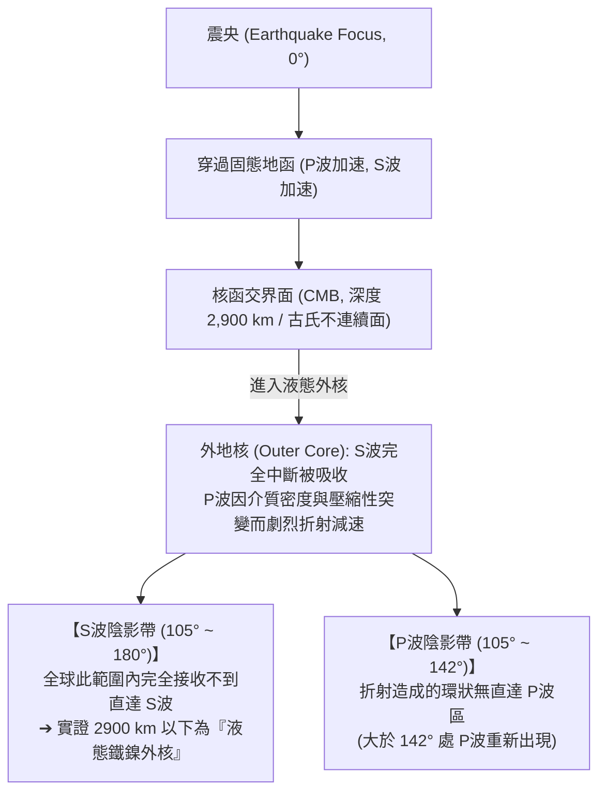

# 地震波與地球內部構造 (Seismic Waves and Earth's Internal Structure)

人類無法直接鑽探地函深處（人類最深鑽井科拉超深井僅 12.2 km，連地殼都未穿透），對地球深部 6,371 公里半徑的圈層認識，主要透過**地震波 (Seismic Waves)** 在不同介質中的傳播、折射、反射與衰減特性解碼而來。

---

## 一、 體波物理性質對比 (Body Waves)

地震發生時向地球深處輻射的「體波 (Body Waves)」主要分為兩大類：

| 體波類型 | 物理振動方式 | 傳播介質能力 | 傳播波速 ($V$) | 探測圈層的關鍵意義 |
| :--- | :--- | :--- | :--- | :--- |
| **P波 (壓縮波 / 縱波 Primary / Compressional Wave)** | 質點振動方向與波行進方向**平行**（疏密波） | **固體、液體、氣體**均可傳播 | 較快 ($V_p \approx 6 \sim 13\text{ km/s}$) | 最早抵達測站，通過不同圈層介質時發生折射與速度躍遷 |
| **S波 (剪切波 / 橫波 Secondary / Shear Wave)** | 質點振動方向與波行進方向**垂直**（剪切波） | **僅限固體**（液體與氣體剪切模量為零，無法傳遞） | 較慢 ($V_s \approx 3.5 \sim 7\text{ km/s}$) | **S波的消失是確認液態圈層（如外地核、部分熔融軟流圈）的直接鐵證** |

---

## 二、 兩大波影區 (Shadow Zones) 與地核發現

當大地震波穿透地球內部時，全球地震測站記錄呈現出規律性的「波影帶 (Shadow Zone)」：

1. **S波陰影帶（角距離 105° ~ 180°）**：
   - 英國地質學家理察·奧爾德姆 (Richard Oldham, 1906) 發現，距震央大於 105° 的地表區域完全記錄不到直達 S波。因為 S波無法穿透液體，這無可辯駁地證實了地球中央存在厚達 2,300 公里的**液態外核**。
2. **P波陰影帶（角距離 105° ~ 142°）**：
   - P波進入密度暴增但剪切彈性為零的液態外核時，波速從地函底部的約 $13.7\text{ km/s}$ 驟降至 $8.1\text{ km/s}$，產生極大的向內折射，導致地表 105° 至 142° 之間形成一圈接收不到直達 P波的環狀陰影區。
3. **內地核的發現（雷曼不連續面）**：
   - 丹麥女地震學家英格·雷曼 (Inge Lehmann, 1936) 敏銳地在 P波陰影區內觀測到了微弱的反彈 P波信號（PKiKP），從而推算出 5,150 公里深度以下存在一個**固態金屬內核**。

---

## 三、 全球地震波斷層掃描 (Global Seismic Tomography)

現代地球物理學利用數千座數位寬頻地震儀陣列與超級電腦反演，發展出如同醫學 CT 斷層掃描的「地震波速度斷層成像」：
- **低速異常區 (Slow Velocity Anomaly, 紅色)**：代表深部溫度偏高或存在部分熔融物質，如地函熱柱（Mantle Plume）與熱點（夏威夷、冰島下方）。
- **高速異常區 (Fast Velocity Anomaly, 藍色)**：代表低溫、剛硬的岩石圈殘骸，清楚成像出隱沒洋殼板塊（如環太平洋板塊）深潛穿透 660 公里過渡帶、沉入 2900 公里核函交界面附近的「板塊墓園」。

---

## 四、 相關參照
- **母體講次**：[[S03-固體地球的演化]]
- **分層機制**：[[地球元素分異作用]]
- **動力關聯**：[[板塊構造學說]]、[[隱沒工廠]]
