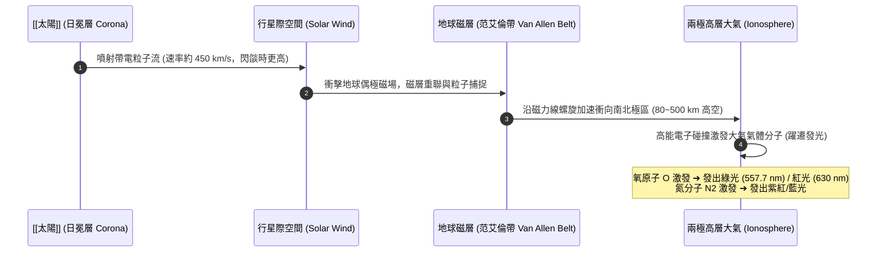

# 太陽風與極光 (Solar Wind and Aurora)

**太陽風 (Solar Wind)** 是由 [[太陽]] 日冕層持續向整個太陽系超音速噴射的高溫、低密度帶電粒子流（主要為高能質子與電子）。而**極光 (Aurora)** 則是太陽風與具內在磁場的行星（如地球、木星、土星）相互作用，在其高緯度兩極大氣層發生的發光物理現象。

---

## 一、 物理傳遞機制

1. **粒子逃逸與噴射**：
   - 太陽日冕溫度超過 1,000,000 K，熱運動劇烈使重力無法完全束縛電離氣體。
   - 帶電粒子以約 450 km/s 的超音速「吹拂」整個太陽系空間。
2. **磁場屏蔽與粒子捕獲**：
   - 地球的地核流體運動產生強大的內在偶極磁場，形成防護屏障（磁層 Magnetosphere），抵擋並偏轉了大部分致命的高能太陽風。
   - 部分高能粒子被地球磁場的**范艾倫輻射帶 (Van Allen Radiation Belt)** 捕捉。
3. **極區撞擊與發光機制**：
   - 當太陽爆發閃燄 (Solar Flare) 或日冕物質拋射 (CME) 引起磁暴時，受擾動的高能電子沿閉合磁力線向南北極區螺旋傾瀉。
   - 粒子撞擊地球 100~300 公里高空的稀薄大氣分子，使氣體原子被游離激發：
     - **氧原子 (Oxygen)**：發射出標誌性的黃綠色光芒（557.7 nm，最常見於 100~150 km）或極高空的微弱紅光。
     - **氮分子 (Nitrogen)**：受到激發與電離後發出深紅、藍色或粉紫色光輝。

---

## 二、 太陽風對太陽系其他星體的影響
1. **彗星彗尾定向**：太陽風的輻射壓與粒子動量決定彗星離子尾的方向——**永遠筆直背向太陽**。
2. **水星大氣剝離**：水星無強磁場且距離太陽極近，太陽風持續轟擊剝離地表物質，形成不斷更換的極稀薄鈉原子「外氣層 (Exosphere)」。
3. **火星大氣流失**：火星磁場在數十億年前停擺後，太陽風剝奪了火星大部分原始二氧化碳與水分，使其成為冰冷荒漠。
4. **木星強烈極光**：木星磁場為地球 10 倍以上，其磁層與極光活動為太陽系最強烈者。

---

## 三、 相關參照
- **源頭天體**：[[太陽]]
- **產物現象**：[[類地行星]]（地球磁場保護）、[[類木行星]]（木星極光）
