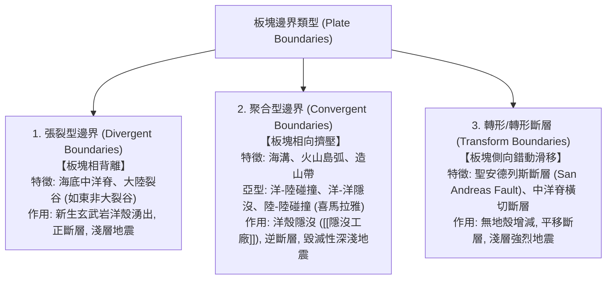

# 板塊構造學說 (Plate Tectonics Theory)

**板塊構造學說 (Plate Tectonics Theory)** 於 1960 年代末期奠定，被譽為地球科學界的「相對論」或「演化論」。該學說統一整合了大陸漂移說、海底擴張說與全球地震震源機制，主張：**地球外層堅硬的岩石圈 (Lithosphere) 並非完整一塊，而是碎裂為數個大型與微型剛性板塊，漂浮於具塑性流動性的軟流圈 (Asthenosphere) 之上相互運動。**

---

## 一、 板塊邊界三大類型 (Plate Boundaries)

板塊間的相對運動在交界處激發了地球上最劇烈的地震、火山與造山運動：

---

## 二、 板塊運動的根本動力機制 (Driving Mechanisms)

究竟是什麼力量在推動重達數十億噸的板塊橫向漂移？現代地質物理學總結了三大主要動力來源：
1. **地函熱對流 (Mantle Convection)**：地球深部放射熱與地核餘熱驅動軟流圈產生大規模熱對流循環（地表板塊即為熱對流的最頂部冷卻邊界層）。
2. **板塊拉力 (Slab Pull)**：**公認最強大的主導動力**。低溫高密度的老化海洋岩石圈在海溝處發生相變（轉化為極高密度的榴輝岩），受重力拖曳強行將後續整個板塊拉入地函。
3. **脊推力 (Ridge Push)**：中洋脊因熱膨脹而隆起高出深海平原 2~3 公里，形成向下傾斜的重力滑動分力。

---

## 三、 環太平洋火圈 (Pacific Ring of Fire)

- 全球超過 **80% 的大型地震**（包括規模 8 以上的特大地震）與 **75% 的活火山**，高度集中排列在太平洋板塊與周圍歐亞板塊、北美板塊、印澳板塊交界之隱沒帶上。
- 印尼（如林賈尼火山 Mt. Rinjani）、日本、智利與**台灣**皆坐落在此一超級地質動態火環之上。

---

## 四、 相關參照
- **母體講次**：[[S04-地體構造與地殼變動]]
- **實體案例**：[[台灣大地構造與地質分區]]
- **前導實證**：[[海底擴張與古地磁條帶]]
- **深部化學流**：[[隱沒工廠]]
