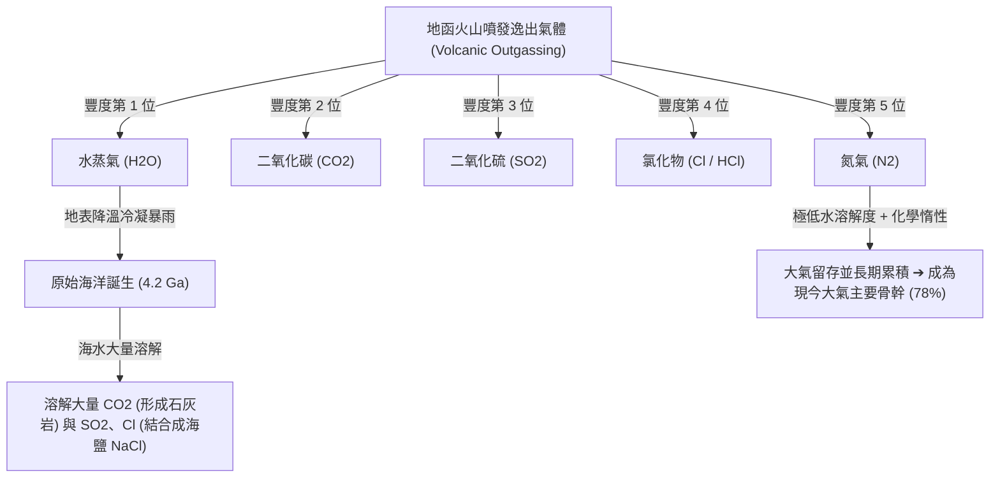

# 次生大氣與火山去氣 (Secondary Atmosphere and Volcanic Outgassing)

地球今日所呼吸的大氣並非 46 億年前太陽星雲的原生殘留物，而是在原始大氣被吹散後，透過持續數億年的微行星撞擊去氣與**火山去氣作用 (Volcanic Outgassing)** 重新釋放沉積而成的**「次生大氣 (Secondary Atmosphere)」**。

---

## 一、 原始大氣為何消失？（T-Tauri 太陽風吹蝕）

在太陽系演化初期，所有內行星原本都吸附了由氫 (H₂) 與氦 (He) 組成的原始星雲包層。然而：
1. **金牛座 T 型星風暴 (T-Tauri Solar Wind)**：原恆星太陽在進入主序帶前的 T-Tauri 階段爆發出強度為現今百萬倍的超強星風，直接吹散了內行星引力較弱的原始大氣。
2. **行星熱運動與分子逃逸**：微行星撞擊聚熱使早期內行星地表處於熔融高溫，低分子量的輕氣體（氫、氦）熱運動速度超越了行星脫離速度，徹底逃逸至太空中。

---

## 二、 火山去氣的化學產物與大氣奠定

次生大氣的原料來自封存於星際微行星與地函內部的揮發性分子。隨著內部熱對流與火山爆發（如皮納土波火山 Mt. Pinatubo 噴發所展現的現代縮影），大量氣體釋放至地表：

---

## 三、 與金星、火星大氣命運的分道揚鑣

| 行星 | 與日距離 | 關鍵環境因數 | 火山去氣後的演化命運 |
| :--- | :--- | :--- | :--- |
| **金星 (Venus)** | 0.72 AU | 過於靠近太陽，水無法冷凝成雨 | 水蒸氣積聚於大氣中引發**失控溫室效應 (Runaway Greenhouse)**，水分子受紫外線光解逃逸，留下 90 大氣壓之純 $\text{CO}_2$ 煉獄。 |
| **火星 (Mars)** | 1.52 AU | 質量太小（地球 1/10）、距日遠冷 | 引力不足無法留住大氣（0.006 atm），水凍結於地下冰層與極冠，無液態水溶解 $\text{CO}_2$，大氣極度稀薄冰冷。 |
| **地球 (Earth)** | 1.00 AU | 距離適中（液態水宜居帶） | **水蒸氣凝結成海**，海洋吸收了 99% 以上的 $\text{CO}_2$，並藉由板塊構造循環固化，造就以 $\text{N}_2$ 為主體的溫和環境，供生命後續演化出氧氣。 |

詳見專題比較：[[金星地球火星大氣演化比較]]。

---

## 四、 相關參照
- **母體講次**：[[S05-大氣的形成與演化]]
- **接續演化**：[[大氣演化與氧氣革命]]、[[層狀鐵礦層與疊層石]]
- **假說支持**：[[稀有地球假說]]
