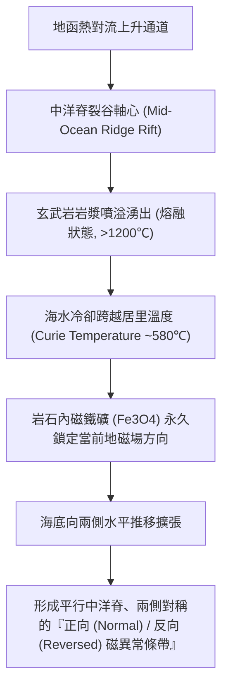

# 海底擴張與古地磁條帶 (Seafloor Spreading and Magnetic Striping)

在 20 世紀中葉，**海底擴張學說 (Seafloor Spreading)** 與**海底地磁逆轉條帶 (Marine Magnetic Striping)** 的發現，是推翻傳統「地槽陸橋固定論」、徹底驗證阿爾弗雷德·韋格納「大陸漂移說」並促成 [[板塊構造學說]] 確立的最核心科學突破。

---

## 一、 古地磁逆轉：大洋中脊的「天然磁帶錄音機」

地球磁場每隔數萬至數十萬年會發生一次極性倒轉（正向期與反向期相互切換）：

1. **熱殘餘磁化 (Thermal Remanent Magnetization, TRM)**：
   - 玄武岩富含磁鐵礦微晶。當岩漿在海底湧出並冷卻至居里溫度（約 580℃）以下時，磁性顆粒的磁矩會順著當時地球磁場的方向排列並被「凍結鎖定」。
2. **瓦因-馬修斯-莫利假說 (Vine-Matthews-Morley Hypothesis, 1963)**：
   - 弗雷德·瓦因 (Fred Vine) 與德拉蒙德·馬修斯 (Drummond Matthews) 提出：若洋底確實從中洋脊向兩側持續分裂擴張，那麼洋殼將忠實記錄每一次地磁倒轉歷史。
   - 實際海洋磁力測量結果顯示：大西洋、太平洋、印度洋中脊兩側，皆精確呈現**寬度與順序完全對稱的黑白相間磁異常條帶**，如同一部巨大的地球磁性錄音帶。

---

## 二、 海底年齡對稱分布與格洛瑪·挑戰者號實證

1. **格洛瑪·挑戰者號 (Glomar Challenger) 深海鑽探計畫 (DSDP, 1968~)**：
   - 透過鑽探洋底沉積物與基底玄武岩進行放射性定年，直接證實：
     - **中洋脊軸部**：洋殼年齡為 0（最新誕生）。
     - **隨距離遞增**：離中洋脊越遠，洋殼年齡越老，沉積物厚度越厚。
     - **全球現存最老洋殼僅約 1.7 ~ 1.8 億年 (170~180 Ma，侏羅紀)**：相較於 38 億年的古老大陸地殼，海洋地殼異常年輕，因為洋殼隨板塊運動不斷在海溝隱沒回地函（詳見 [[隱沒工廠]]）。

---

## 三、 相關參照
- **母體講次**：[[S04-地體構造與地殼變動]]
- **延伸學說**：[[板塊構造學說]]
- **循環歸宿**：[[隱沒工廠]]
