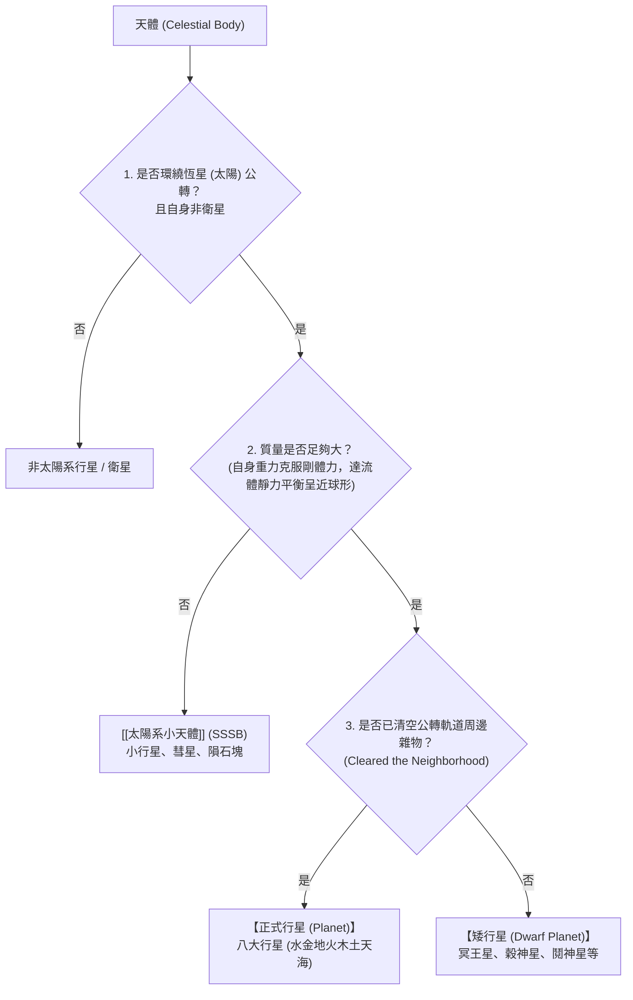

# 行星定義 (Planetary Definition)

**行星定義 (Planetary Definition)** 依據 **國際天文學聯合會 (International Astronomical Union, IAU)** 於 2006 年 8 月 24 日在捷克布拉格第 26 屆大會通過的 **Resolution B5** 決議案，正式確立了太陽系天體的標準分類準則，終結了長達數十年的「冥王星行星地位爭議」。

---

## 一、 現代行星的三大核心準則

一個天體若要在太陽系中被正式認定為**「行星 (Planet)」**，必須同時滿足下列三項條件：

1. **條件一：繞恆星（太陽）運行**（In orbit around the Sun），且不是其他行星的衛星。
2. **條件二：具足夠質量達流體靜力平衡 (Hydrostatic Equilibrium)**（呈近乎圓球形的外貌）。
3. **條件三：已清除其軌道鄰近區域中的其他天體 (Cleared the neighborhood around its orbit)**：
   - 該天體在引力上必須處於絕對支配地位，軌道周邊不能有其他質量相當但未受其引力俘獲或共振控制的同軌天體。

---

## 二、 冥王星被降級的科學關鍵：條件三未通過

冥王星 (Pluto) 於 1930 年由克萊德·湯博 (Clyde Tombaugh) 發現，曾作為第九大行星長達 76 年。但在 1990 年代起，天文學家於海王星外柯伊伯帶 (Kuiper Belt) 陸續發現大量質量相仿的天體（如 2005 年發現的鬩神星 Eris / 2003 UB313，其質量甚至略高於冥王星）：

- **未能清空軌道**：冥王星的公轉軌道與海王星交叉，且柯伊伯帶中充斥著數以萬計未被其重力吸納或逐出的冰質星體。
- **冥王星系統質量比**：冥王星的質量僅佔其軌道內所有天體總質量的極小比例（與地球佔其軌道物質 99.999% 的引力主導力無法相比）。
- **決議結果**：IAU 將冥王星與穀神星 (Ceres)、鬩神星 (Eris) 歸類為全新級別——**[[矮行星與小行星帶|矮行星 (Dwarf Planet)]]**，並賦予小行星編號 134340。

---

## 三、 相關參照
- **母體講次**：[[S02-星球的誕生]]
- **實體分類**：[[類地行星]]、[[類木行星]]、[[矮行星與小行星帶]]
- **綜合比較**：[[八大行星與矮行星綜合比較]]
