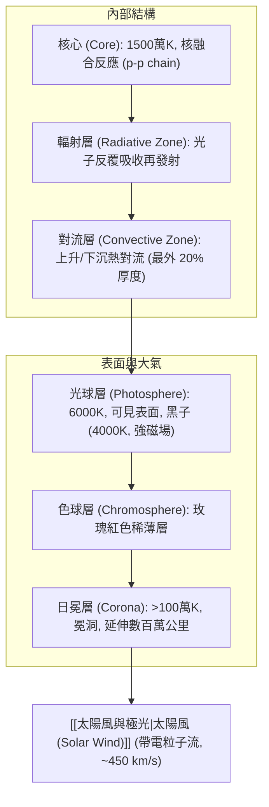
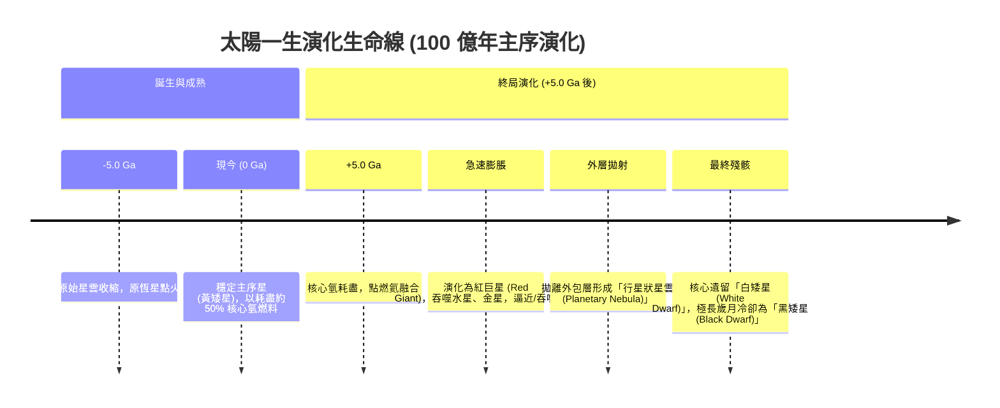

# 太陽 (The Sun)

**太陽 (The Sun)** 是銀河系千億顆恆星中的一顆黃矮星（光譜型 G2V），是太陽系的中心天體，集中了全太陽系 **99.8% 以上的總質量**。其核心源源不絕的熱核反應為全太陽系提供光、熱，並藉由 [[太陽風與極光|太陽風]] 塑造了整個日光層 (Heliosphere)。

---

## 一、 基本物理與化學組態
- **質量比例**：佔太陽系 99.8%（剩餘 0.2% 質量大部分在木星）。
- **元素豐度**：
  - 按質量計：氫 (H) ~75%、氦 (He) ~25%、重元素 (金屬度 Z) ~0.1%。
  - 按原子數量計：氫 92.1%、氦 7.8%、其餘 0.1%。
- **核心環境**：核心溫度高達 1,500 萬 K，壓力達 2,500 億大氣壓，氣體密度被劇烈壓縮達水的 150 倍。
- **較差自轉 (Differential Rotation)**：非剛體旋轉，表面自轉週期赤道約 25.4 天，兩極增至 36 天；該效應延伸至對流層底部，輻射層與核心則呈現如固體般的剛性同速旋轉。

---

## 二、 能量產生與圈層構造

太陽的能量輸出功率達 $3.86 \times 10^{23} \text{ kW}$，來自核心的**質子-質子鏈核融合反應 (p-p chain)**：每秒約有 7 億公噸的氫融合成 6 億 9 千 5 百萬公噸的氦，損失之 5 百萬公噸質量轉換為高能 $\gamma$ 射線，歷經十餘萬年散射降頻至表面成為可見光。

---

## 三、 太陽的生命史與演化終局

太陽目前年齡約 50 億年，處於穩定的主序星中年階段，剩餘核心氫燃料約可再維持 50 億年：

---

## 四、 相關參照
- **母體講次**：[[S02-星球的誕生]]
- **主導現象**：[[太陽元素分異作用]]、[[太陽風與極光]]、[[星雲假說]]
