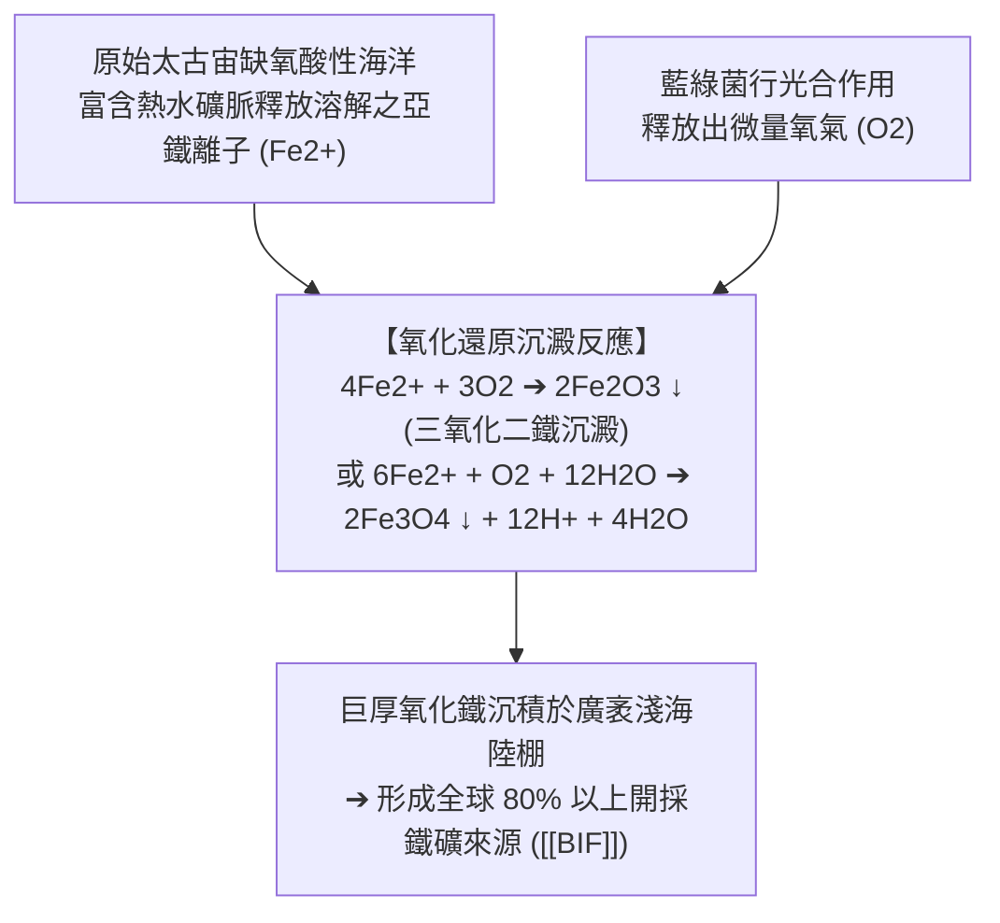

# 層狀鐵礦層與疊層石 (Banded Iron Formations and Stromatolites)

**層狀鐵礦層 (Banded Iron Formations, 簡稱 BIF)** 與**疊層石 (Stromatolites)** 是地質學家用以證實地球早期生命演化、原始海洋化學特徵以及 [[大氣演化與氧氣革命]] 的兩大最具指標性的古老地質化石證據。

---

## 一、 藍綠菌與疊層石 (Stromatolites)

- **定義與成因**：疊層石是早期具光合自營能力的微生物（主要為藍綠菌 / 藍藻 Cyanobacteria）黏附並膠結海水中的細粒碳酸鈣與沉積碎屑，經日復一日向光向上生長所形成的具細密層狀構造之生物沉積石。
- **年代跨度**：
  - 最古老疊層石化石見於西澳洲皮爾巴拉 (Pilbara) 與格陵蘭，年代達 **35 億年前 (3.5 Ga)**。
  - 證實在太古宙初期，地球海洋中已演化出能利用太陽光、水與二氧化碳製造有機物並副產氧氣的微生物群。
- **現代活化石產地**：澳洲西岸鯊魚灣 (Shark Bay)。該區因極度高鹽、抑制了啃食微生物的軟體動物生存，保留了與 30 億年前完全相同的活體藍綠菌疊層石群落。

---

## 二、 層狀鐵礦層 (Banded Iron Formations, BIF)

- **岩相特徵**：由富含鐵氧化物（如磁鐵礦 $\text{Fe}_3\text{O}_4$、赤鐵礦 $\text{Fe}_2\text{O}_3$）之深黑或暗紅條帶，與富含微晶質二氧化矽（燧石 / 碧玉 Chert/Jasper）之淺色條帶相互交替互層構成。
- **形成機制：生源氧氣與海洋鐵庫的氧化沉澱反應**：

---

## 三、 BIF 的消失與陸地紅層 (Red Beds) 的接棒

在地質年代地層剖面上，BIF 的興衰呈現極其劇烈的時間窗口：

| 時代區間 | 主導鐵沉積相 | 海洋與大氣氧化還原狀態 |
| :--- | :--- | :--- |
| **3.5 ~ 2.4 Ga (太古宙)** | **全球廣泛沉積 BIF** (如西澳 Murchison 金礦區、北極 Isua) | 海水富含 $\text{Fe}^{2+}$，氧氣被鐵離子全數攔截消耗，大氣處於嚴格**無氧還原狀態**。 |
| **2.4 ~ 2.0 Ga (元古宙早期)** | **BIF 沉積急劇衰退並終結** | 海水鐵庫被消耗殆盡，氧氣首次溢出海洋進入大氣（[[大氣演化與氧氣革命|氧氣革命 GOE]]）。 |
| **2.2 Ga 以後 ~ 顯生宙** | **陸地紅色沉積岩層 (Red Beds)** 大量普及 | 大氣富氧，陸地河湖沉積物直接受大氣氧氣氧化，二價鐵風化轉化為三價赤鐵礦染成紅色。 |

---

## 四、 相關參照
- **母體講次**：[[S05-大氣的形成與演化]]
- **對應大機制**：[[大氣演化與氧氣革命]]
- **時間維度定位**：[[地球歷史與大尺度演化時間軸]]
