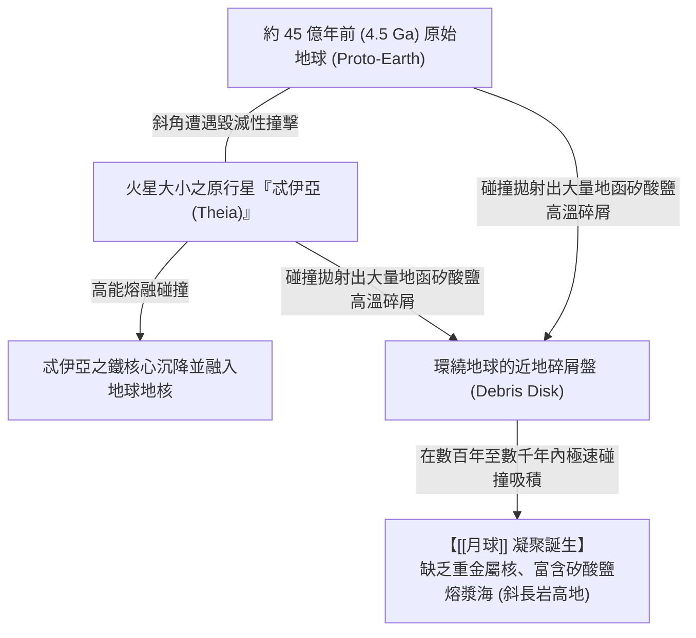

# 月球 (The Moon)

**月球 (The Moon)** 是地球唯一的天然衛星，距地球約 384,400 公里。相較於木星或土星的微小衛星比例，月球直徑約為地球的 1/4（質量約為地球的 1/81），這種不相稱的超大比例在類地行星中絕無僅有，對地球的自轉傾角穩定、潮汐摩擦與生命演化具有決定性影響（詳見 [[稀有地球假說]]）。

---

## 一、 起源：忒伊亞大碰撞假說 (Theia Giant Impact Hypothesis)

阿波羅登月計畫 (Apollo Missions) 帶回的月岩樣本顯示：月球的氧同位素組成與地球地函完全一致，但月球極度缺乏鐵鎳金屬核心且嚴重揮發分虧損。這否定了「捕獲說」與「同源分裂說」，奠定了**大碰撞假說 (Giant Impact Hypothesis)**：

---

## 二、 地球－月球潮汐演化動力學

1. **潮汐摩擦與減速**：
   - 月球對地球海洋與固體地幔施加強大引力，引發潮汐凸起。由於地球自轉速度快於月球公轉速度，潮汐凸起超前於地月連線，對地球自轉產生向後的制動力矩，導致地球自轉每日變長（約每世紀增加 1.7 毫秒）。
2. **月球逐漸遠離**：
   - 依據角動量守恆，地球失去的自轉角動量轉移為月球軌道公轉角動量，使月球每年以約 **3.8 公分** 的速率逐步遠離地球。
3. **終極平衡狀態**：
   - 宋聖榮教授指出：地月系統未來將持續演化，直到月球繞地球公轉一周為 55 天，地球自轉一周亦為 55 天時，雙方完全達到雙向潮汐鎖定之動力學平衡。

---

## 三、 地球生命的守護者角色
1. **穩定自轉軸傾角**：月球巨大的潮汐力錨定了地球約 23.44° 的自轉軸傾角，避免了如同火星那樣在數百萬年間傾角於 10° 至 60° 之間劇烈擺動所造成的致命氣候崩潰。
2. **潮汐區生態過渡**：廣袤潮間帶的日夜乾濕交替，為早期海洋生物登陸提供了理想的緩衝演化生態位。

---

## 四、 相關參照
- **母體講次**：[[S03-固體地球的演化]]
- **起源碰撞**：[[微行星吸積]]、[[地球元素分異作用]]
- **生命宜居性**：[[稀有地球假說]]
