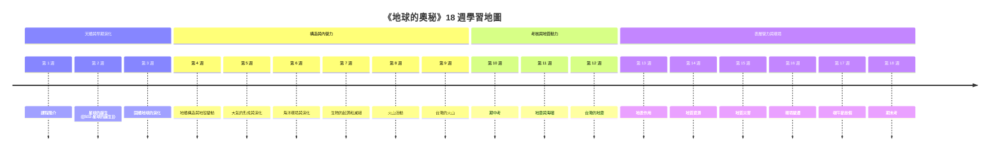

# 第 1 講 課程介紹 (Course Overview)

- **課程名稱**：地球的奧秘 (Investigating the Earth)
- **授課教師**：國立臺灣大學地質科學系 [[宋聖榮教授]]
- **核心參考書籍**：《地球是孤獨的》(Rare Earth: Why complex life is uncommon in the Universe; Peter D. Ward & Donald Brownlee) —— 詳見 [[稀有地球假說]]。
- **授課方式**：第一小時影片教學，第二小時上課講解。
- **評分標準**：期中考 40%、期末考 40%、課堂小考/出席/報告 20%。

---

## 一、 全學期 18 週課程大綱與地質主題架構

本課程共劃分為 15 個核心地學主題（另含期中、期末考與放假），涵蓋從天文起源、固體地球結構、表面營力、地質災害到環境變遷的完整光譜：

---

## 二、 地球歷史大尺度宏觀時間表

宋教授在第 1 講中建立了全課程最重要的「地質時間概念尺度」（單位：十億年 Ga / 百萬年 Ma）：

| 時間尺度 | 關鍵事件 (Geological Event) | 關聯實體與概念 |
| :--- | :--- | :--- |
| **13.8 Ga (138 億年前)** | 大霹靂 (Big Bang) 與宇宙誕生 | 宇宙元素合成 |
| **11.0 Ga (110 億年前)** | 第一個星系產生 | 銀河系演化 |
| **5.0 ~ 4.6 Ga** | 太陽系與原始地球形成 | [[星雲假說]]、[[微行星吸積]] |
| **4.2 Ga (42 億年前)** | 原始海洋冷凝形成 | 水圈形成、大氣去氣作用 |
| **3.8 Ga (38 億年前)** | 最古老大自然岩石與原始大陸地殼形成 | 固體地殼冷卻 |
| **3.6 Ga (36 億年前)** | 最古老的生命證據出現（微化石/疊層石） | 原始生命起源 |
| **2.0 Ga (20 億年前)** | 氧氣革命 (Great Oxidation Event, GOE) 開始 | 光合自營生物、大氣組態轉變 |
| **0.8 Ga (8 億年前)** | 海洋與大氣成分維持穩定（近似現今） | 多細胞生物爆發前夕 |
| **510 Ma (5.1 億年前)** | 魚類出現與海洋無脊椎動物繁盛 | 古生代早期海洋生態 |
| **170 Ma (1.7 億年前)** | 盤古大陸 (Pangea) 分裂、現存最古老海洋地殼形成 | 板塊構造運動 |
| **66 Ma (6600 萬年前)** | 白堊紀-古近紀大滅絕 (K-Pg Extinction)，恐龍滅絕 | 隕石撞擊、地質大滅絕 |
| **50 Ma (5000 萬年前)** | 哺乳動物大輻射與新生代繁盛 | 新生代陸域生態 |
| **3 Ma (300 萬年前)** | 人科靈長類出現 | 第四紀人類演化 |

---

## 三、 本講引申之核心 Wiki 頁面
- **科學假說**：[[稀有地球假說]]
- **綜合分析**：[[地球歷史與大尺度演化時間軸]]
- **接續主題**：[[S02-星球的誕生]]
