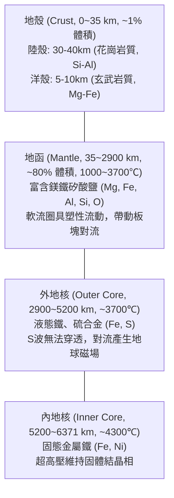

# 第 3 講 固體地球的演化 (Evolution of the Solid Earth)

- **授課教師**：國立臺灣大學地質科學系 宋聖榮教授
- **核心主旨**：聚焦於地球 46 億年來固體內部圈層（地核、地函、地殼）的成形機制、熱動力學驅動、地震波探測原理、[[隱沒工廠]] 的地殼循環物質流，以及月球大碰撞起源。

---

## 一、 固體地球熱源與化學分異

地球年齡定為 **46 億年 (4.6 Ga)**，直接證據來自於古代殘留隕石（如美國巴林傑隕石坑 Barringer Crater、澳洲狼溪隕石坑 Wolfe Creek）。

地球在 46~35 億年前經歷了大規模熔融，其關鍵熱來源包括：
1. **重力收縮位能轉化之殘餘熱**
2. **行星微粒與微行星劇烈撞擊之動能熱**
3. **內部放射性核種衰變熱**（短半衰期與長半衰期元素）
4. **地球自轉摩擦與角動量轉換熱**

在超過 1000℃ 的岩漿海環境中，驅動了強烈的 [[地球元素分異作用]]：
- **金屬隕石成分**：對應於地球的「地核 (Core)」，以鐵 (Fe)、鎳 (Ni) 等高密度親鐵元素沉降至深部。
- **石隕石成分**：對應於地球的「地函 (Mantle)」與「地殼 (Crust)」，輕質矽酸鹽浮升冷凝。

---

## 二、 地震波與內部構造探測

人類無法直接鑽探地函與地核，依賴地震波物理特性解碼地球深部圈層：
- **P波 (壓縮波 / 縱波 Pressure waves)**：質點振動平行波傳遞方向，可在固體、液體、氣體中傳播。
- **S波 (剪切波 / 橫波 Shear waves)**：質點振動垂直波傳遞方向，**僅能在剪切剛性固體中傳播，無法穿透液體**。
- **波影區 (Shadow Zone)**：
  - **S波陰影帶 (105° ~ 180°)**：完全接收不到直達 S波，**直接證實了地表 2900 公里以下存在液態外核**。
  - **P波陰影帶 (105° ~ 142°)**：因通過核函交界 (CMB / Gutenberg Discontinuity) 產生強烈折射而形成環狀無直達波帶。
- **全球地震波斷層掃描 (Global Seismic Tomography)**：利用密集地震儀網觀測波速異常（高溫慢速區 vs 低溫高速冷板塊），清晰揭示板塊深潛至核函邊界與軟流圈地函柱熱對流。

詳見專題：[[地震波與地球內部構造]]。

---

## 三、 地殼構造與「隱沒工廠」物質循環

- **大陸地殼 vs 海洋地殼**：
  - **大陸地殼 (Continental Crust)**：平均厚 30~40 km，主要由**花崗岩質 (Granitic)** 岩石組成，富含矽鋁 (Si-Al)，密度較低 (~2.7 g/cm³)，不易被隱沒消滅。
  - **海洋地殼 (Oceanic Crust)**：平均厚 5~10 km，主要由**玄武岩質 (Basaltic)** 岩石組成，富含鎂鐵 (Mg-Fe)，密度較高 (~3.0 g/cm³)，不斷在中洋脊生成並於海溝隱沒。
- **[[隱沒工廠]] (The Subduction Factory)**：
  - 海洋岩石圈脫水釋放揮發分（H₂O），誘發上覆地函橄欖岩部分熔融產生岩漿。
  - 岩漿在庫內經歷結晶分異作用 (Fractional Crystallization)，演化出酸性花崗岩質熔岩，累積形成穩定大陸地殼，殘餘冷板塊則沉降回地函深處。

---

## 四、 月球的起源：忒伊亞大碰撞假說 (Theia Giant Impact)

- **忒伊亞 (Theia) 碰撞**：約 45 億年前，一顆火星大小的原行星（忒伊亞）以斜角撞擊原始地球，拋射出的地函矽酸鹽碎屑在近地軌道吸積成 [[月球]]。
- **地球－月球潮汐系統**：月球對地球施加強大潮汐減速力，使地球自轉逐步放慢，月球每年以約 3.8 cm 遠離地球；兩者將持續演化至自轉公轉週期皆為 55 天的雙向潮汐鎖定平衡。

---

## 五、 本講引申之核心 Wiki 頁面
- **探測機制**：[[地震波與地球內部構造]]、[[隱沒工廠]]
- **延伸構造**：[[板塊構造學說]]、[[台灣大地構造與地質分區]]
- **天體關聯**：[[月球]]、[[類地行星]]
- **前導/後續主題**：[[S02-星球的誕生]] ➔ [[S04-地體構造與地殼變動]]
