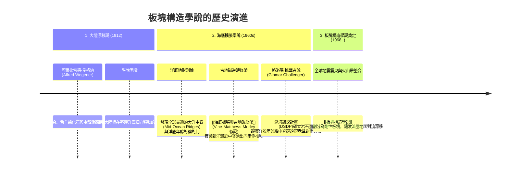

# 第 4 講 地體構造與地殼變動 (Plate Tectonics and Crustal Deformation)

- **授課教師**：國立臺灣大學地質科學系 宋聖榮教授（協同：胡植慶教授、陳文山教授研究資料）
- **核心主旨**：回顧 20 世紀地球科學最偉大的革命——從大陸漂移、海底擴張到 [[板塊構造學說]] 的演進軌跡；並以台灣為天然構造實驗室，剖析活躍的「弧陸碰撞 (Arc-Continent Collision)」與台灣五大地質分區。

---

## 一、 板塊構造學說的演化三部曲



1. **古地磁逆轉條帶 (Magnetic Striping and Polar Reversals)**：
   - 地球磁場週期性倒轉（正向期與反向期）。
   - 中洋脊岩漿冷凝跨越居里溫度 (Curie Temperature) 時，磁鐵礦鎖定當期地磁方向。中洋脊持續湧出擴張，形成平行於脊軸、兩側對稱的磁異常條帶，成為地殼擴張的「天然磁帶錄音機」。
2. **環太平洋火圈 (Pacific Ring of Fire)**：
   - 全球 80% 以上的大地震與活躍火山高度集中於板塊隱沒邊界。

---

## 二、 台灣大地構造環境：劇烈的「弧陸碰撞」

台灣島位於**歐亞大陸板塊 (Eurasian Plate)** 與**菲律賓海板塊 (Philippine Sea Plate)** 的聚合型板塊交界帶上，是全球構造活動最劇烈、造山運動最迅速的區域之一：

```mermaid
graph TD
    subgraph 東北側構造 (東北向)
        RyukyuTrench["琉球海溝 (Ryukyu Trench)"] ---|菲律賓海板塊向北隱沒| RyukyuSlab["歐亞板塊之下"]
        RyukyuSlab --> OkinawaTrough["沖繩海槽 (Okinawa Trough, 弧後擴張後裂盆地)"]
    end
    
    subgraph 中央核心動力: 弧陸碰撞
        PSP["菲律賓海板塊 (每年約 8 cm 朝西北推進)"] -->|載運呂宋火山島弧| Collision["強烈碰撞歐亞大陸被動大陸邊緣 (Arc-Continent Collision)"]
        Collision --> Mountain["快速擠壓造山: 中央山脈與雪山山脈迅速抬升"]
    end
    
    subgraph 南側構造 (西南向)
        ManilaTrench["馬尼拉海溝 (Manila Trench)"] ---|歐亞板塊向東隱沒| ManilaSlab["菲律賓海板塊之下 (增生柱演化)"]
    end
```

- **雙隱沒系統的轉折樞紐**：
  - 台灣以北：菲律賓海板塊沿**琉球海溝**向北隱沒至歐亞板塊下方，伴隨**沖繩海槽**的弧後張裂。
  - 台灣以南：歐亞板塊海盆沿**馬尼拉海溝**向東隱沒至菲律賓海板塊下方。
  - 台灣島本身：正處於呂宋島弧與歐亞大陸邊緣強烈擠壓碰撞的「碰撞帶頂點」，隱沒帶在此發生轉換。

---

## 三、 台灣地質構造五大分區（由東向西）

宋聖榮教授與陳文山教授研究將台灣本島剖析為五大構造岩相帶：

| 構造分區 | 構造屬性與岩石特徵 | 關鍵地理地貌與成因 |
| :--- | :--- | :--- |
| **1. 海岸山脈 (Coastal Range)** | 增生併貼的火山島弧沉積岩與安山岩質火山碎屑岩 | 屬於菲律賓海板塊之前緣，由原呂宋火山島弧碰撞刮削而來 |
| **2. 花東縱谷 (Longitudinal Valley)** | 板塊碰撞縫合帶 (Tectonic Suture Zone) | 兩大板塊之直接界線（花東縱谷斷層），地盤位移與地震頻繁 |
| **3. 中央山脈 (Central Range)** | 古老變質基盤、變質雜岩、變質砂岩與板岩 | 台灣的脊樑，歐亞板塊受擠壓強烈變質抬升之造山核心 |
| **4. 雪山山脈 (Hsuehshan Range)** | 古近紀厚層深海石英砂岩、板岩與千枚岩 | 漸新世裂谷盆地沉積物受擠壓反轉逆衝抬升之亞變質岩帶 |
| **5. 西部麓山帶 (Western Foothills)** | 新生代淺海沉積岩（砂頁岩互層），強烈褶皺與逆衝斷層帶 | 前陸褶皺逆衝帶 (Fold-and-thrust belt)，車籠埔斷層、旗山斷層所在 |
| **6. 海岸平原 (Coastal Plain)** | 全新世最新河流沖積層與前陸盆地沉積 | 現代沉積物堆積區，含彰化平原、嘉南平原、台南台地 |

詳見專題頁面：[[台灣大地構造與地質分區]]。

---

## 四、 本講引申之核心 Wiki 頁面
- **作用機制**：[[板塊構造學說]]、[[海底擴張與古地磁條帶]]、[[隱沒工廠]]
- **實體構造**：[[台灣大地構造與地質分區]]
- **前導/後續主題**：[[S03-固體地球的演化]] ➔ [[S05-大氣的形成與演化]]
