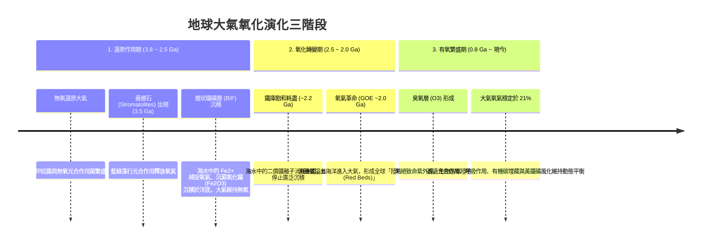

# 第 5 講 大氣的形成與演化 (Formation and Evolution of the Atmosphere)

- **授課教師**：國立臺灣大學地質科學系 宋聖榮教授
- **核心主旨**：探討地球大氣從原始星雲氣體逸散、[[次生大氣與火山去氣]] 的還原狀態，歷經生命藍綠菌演化與 [[大氣演化與氧氣革命]]，最終在岩石圈地質證據（[[層狀鐵礦層與疊層石]]）見證下轉變為現代富氧氧化大氣的漫長歷程；並藉由金星、火星的大氣命運對比突顯地球的特殊性。

---

## 一、 原始大氣 vs. 次生大氣的轉變

1. **原始大氣（Primary Atmosphere）的瓦解**：
   - 46 億年前太陽星雲凝聚時，地球周圍被富含氫 (H₂) 與氦 (He) 的星雲氣體包圍。
   - **金牛座 T 型星階段 (T-Tauri Star Phase)**：太陽剛誕生時爆發極其劇烈的超強太陽風，將內行星軌道上的原始輕氣體全數吹散驅離。因此，**所有類地行星現存的大氣皆為「次生大氣 (Secondary Atmosphere)」**。
2. **次生大氣的成因：火山去氣作用 (Volcanic Outgassing)**：
   - 富含揮發成分的微行星與隕石撞擊地表釋放熱能與氣體；
   - 持續不斷的地函對流與火山活動噴出巨量氣體，噴出物主要成分按豐度排序為：
     $$\text{H}_2\text{O} > \text{CO}_2 > \text{SO}_2 > \text{Cl}_2 / \text{HCl} > \text{N}_2$$
   - **水蒸氣凝結成海**：地球表面冷卻後，巨量水蒸氣成雲降雨，沉降形成原始海洋（4.2 Ga）。
   - **二氧化碳溶解**：降雨雨水與海水大量溶解酸性氣體（$\text{CO}_2$、$\text{SO}_2$、$\text{Cl}^-$，後者與鈉反應沉澱為鹽類 $\text{NaCl}$）。
   - **氮氣成為主體**：由於氮氣 ($\text{N}_2$) 化學性質極為惰性且在水中的溶解度極低，逐漸在大氣中穩定富集。

---

## 二、 早期地球的「還原環境」與生命孕育

- **無游離氧的早期大氣**：早期的微量游離氧會迅速與地殼及海洋中溶解的還原態二價鐵 ($\text{Fe}^{2+}$) 反應而耗盡。早期大氣屬於嚴格的**還原環境 (Reducing Environment)**。
- **還原環境對生命的必要性**：有機單體（胺基酸、核苷酸）若在氧化環境中會被極速氧化破壞，故還原環境是原始生命化學起源（無機轉有機）的先決條件。
- **硫光化學作用防護屏障**：在無臭氧層（$\text{O}_3$）保護的早期，火山排放的八硫分子 ($\text{S}_8$) 能有效吸收紫外線，防止氨氣 ($\text{NH}_3$) 光解，為早期微生物提供生存遮罩。

---

## 三、 大氣演化的地質里程碑：[[層狀鐵礦層與疊層石]]

宋教授指出，地質學家透過地層岩石記錄精確鎖定大氣氧化歷程：

- **縞狀/層狀鐵礦床 (Banded Iron Formation, BIF)**：約在 35 億年前開始沉積，於 22 億年前達到高峰後驟減。全球 83% 的累積氧氣實際上被固化封存在地層中的三氧化二鐵 ($\text{Fe}_2\text{O}_3$) 內。
- **陸地紅層 (Red Beds)**：22 億年前（2.2 Ga）地表沉積物首度出現三價鐵礦氧化染紅的紅層砂岩，標誌著大氣圈正式進入富氧氧化時代。

---

## 四、 本講引申之核心 Wiki 頁面
- **作用機制**：[[大氣演化與氧氣革命]]、[[次生大氣與火山去氣]]
- **實體與證據**：[[層狀鐵礦層與疊層石]]
- **跨行星比較**：[[金星地球火星大氣演化比較]]
- **前導/後續主題**：[[S04-地體構造與地殼變動]] ➔ [[S06-海洋環境與演化]] (待匯入)
