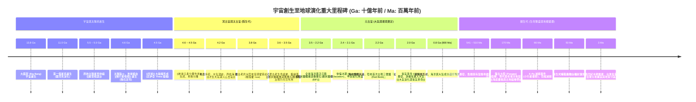

# 地球歷史與大尺度演化時間軸 (Deep Time History of the Earth)

本篇綜合《地球的奧秘》課程中的地質時間尺度（Deep Time），將 138 億年宇宙大歷史與 46 億年地球地質演化編織為具體的時間軸線與階段對照。

---

## 一、 大尺度演化時間軸 (Deep Time Timeline)

---

## 二、 演化關鍵拐點解析

1. **4.6 Ga ➔ 4.5 Ga：星體吸積與圈層分立**
   - 從星際塵埃經由 [[微行星吸積]] 聚集成型。
   - 劇烈熔融形成岩漿海，經 [[地球元素分異作用]] 確立重金屬地核與輕質矽酸鹽地函地殼，奠定日後板塊構造與地磁場防護基礎。
2. **4.2 Ga ➔ 3.8 Ga：海洋水圈冷凝與原始陸核成形**
   - 伴隨強烈排氣作用，高溫水蒸氣在冷卻的地表降雨冷凝為原始海洋。
   - 3.8 Ga 形成現存最古老的大陸地殼殘留體，地球正式告別熔融動盪的冥古宙。
3. **2.0 Ga：大氣氧氣革命 (Great Oxidation Event)**
   - 藍綠菌光合作用產生游離氧氣，首先氧化溶解在海洋中的亞鐵離子形成全球「帶狀鐵礦層 (BIF)」，隨後氧氣逸散進入大氣，徹底轉變地球大氣的氧化還原狀態。
4. **66 Ma ➔ 3 Ma：恐龍滅絕與人類紀元初露**
   - 66 Ma 的地外天體撞擊與火山大噴發終結中生代爬行類霸權，騰出陸域生態位，催生新生代哺乳動物繁盛，直至 300 萬年前出現人屬祖先。

---

## 三、 相關參照
- **來源講次**：[[S01-課程介紹]]、[[S02-星球的誕生]]
- **對應假說**：[[稀有地球假說]]、[[星雲假說]]
- **後續深入**：[[S03-固體地球的演化]] (待匯入)、[[S07-生物的起源和滅絕]] (待匯入)
