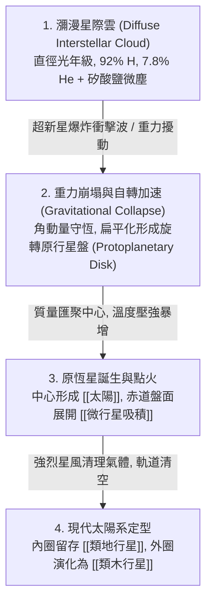

# 星雲假說 (Nebular Hypothesis)

**星雲假說 (Nebular Hypothesis)**，現代又稱**太陽星雲理論 (Solar Nebula Theory)**，是當前科學界解釋太陽系起源與行星系統形成的標準模型。最早由伊曼努爾·康德 (Immanuel Kant, 1755) 與皮埃爾-西蒙·拉普拉斯 (Pierre-Simon Laplace, 1796) 提出雛形，經由 20 世紀現代天文物理學與吸積盤理論進一步完善。

---

## 一、 理論核心論述與四階段演化

星雲假說主張：**太陽與其八大行星源於同一團低溫、旋轉的星際氣體塵埃雲（星雲），在大致相同的時間窗口內一體生成。**

1. **重力崩塌與角動量守恆**：
   - 當星雲質量超過金斯質量 (Jeans Mass) 時，自引力壓倒熱壓力引發向心收縮。
   - 依據角動量守恆定律 ($L = mvr$)，收縮半徑減小時自轉角速度急劇加速，離心力將星雲垂直於轉軸壓平成圓盤狀（原行星盤）。
2. **熱梯度與分異冷凝**：
   - 中心原恆星釋放強烈輻射，建立了由內向外的強烈溫度差，直接驅動了 [[太陽元素分異作用]]。
3. **固態物質聚集與清理**：
   - 盤面微塵透過 [[微行星吸積]] 生成千米級微行星與原行星。木星等巨行星快速吸積大量星雲氣體，而太陽進入金牛座 T 階段時爆發強勁星風，將剩餘未被捕獲之游離氣體吹散至太陽系外，留下今日所見的行星配置。

---

## 二、 現代天文觀測支持證據
1. **同向性與共面性**：八大行星公轉方向與太陽自轉方向完全一致（反時針逆行方向），公轉軌道近乎共面（偏角甚小），軌道幾近圓形。
2. **深空原恆星盤觀測**：哈伯望遠鏡與 ALMA 陣列在獵戶座大星雲、金牛座 HL 等年輕恆星周圍，直接觀測到與假說預測完全一致的原行星盤與同心環狀間隙。
3. **隕石同位素年齡**：碳質球粒隕石中富含的難熔包體 (CAI) 定年結果高度一致於 **45.67 億年前 (4.567 Ga)**，標記了太陽系固體形成的時間起點。

---

## 三、 相關參照
- **驅動之子機制**：[[太陽元素分異作用]]、[[微行星吸積]]
- **對應生成物**：[[太陽]]、[[類地行星]]、[[類木行星]]、[[矮行星與小行星帶]]
