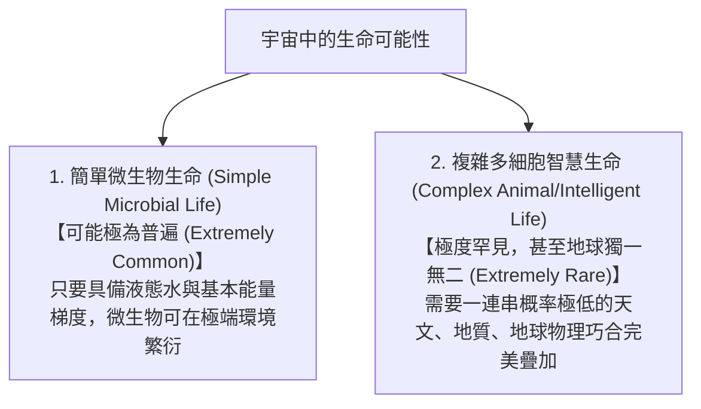

# 稀有地球假說 (Rare Earth Hypothesis)

**稀有地球假說 (Rare Earth Hypothesis)** 由古生物學家彼得·沃德 (Peter D. Ward) 與天文學家唐納德·布朗利 (Donald Brownlee) 於 2000 年合著的經典名著《地球是孤獨的》(Rare Earth: Why Complex Life is Uncommon in the Universe) 中提出。

該假說為《地球的奧秘》課程宋聖榮教授指定之核心參考論著，其核心思想貫穿了整個學期的地質學、大氣學與生命演化討論。

---

## 一、 假說核心命題

稀有地球假說的核心主張可劃分為兩個相互對比的層次：

---

## 二、 支撐複雜生命誕生的「地球巧合清單」

本假說列舉了地球演化史上數十個關鍵的「幸運條件」，其中涉及課程所講述的核心地質概念：

1. **銀河系宜居帶 (Galactic Habitable Zone, GHZ)**：
   - 太陽系距離銀河系中心適中（約 2.7 萬光年）。若太靠近中心，強烈超新星爆炸與黑洞高能輻射將摧毀生命；若太靠近邊緣，重元素（鐵、矽等）豐度不足以形成固態岩石行星。
2. **黃金恆星系統**：
   - [[太陽]] 是單一恆星（無雙星軌道紊亂問題），屬於光譜 G 型主序星，壽命長達 100 億年，光度與能量輸出極為穩定，提供足夠漫長的時間窗口（約 40 億年）供複雜生命演化。
3. **恆星宜居帶與軌道偏心率**：
   - 地球距日 1.0 AU，處於「液態水恆星宜居帶」的正中心，且公轉軌道近乎完美圓形（偏心率僅 0.0167），避免了極端酷熱與酷寒震盪。
4. **木星作為「宇宙吸塵器」**：
   - [[木星]] 巨大引力清理了內太陽系的大多數彗星與小行星威脅，大幅降低地球遭遇大滅絕等級撞擊的頻率（若撞擊頻率提高千倍，複雜生命將無法累積多樣性）。
5. **合適的行星質量與[[地球元素分異作用]]**：
   - 質量夠大，重力得以保留適度厚度的大氣層，避免氣體逃逸；但又不像類木行星那樣吸積過量氣體成為氣態巨行星。
   - 熔融地核維持強大偶極磁場，有效屏蔽致命的 [[太陽風與極光|太陽風]] 與宇宙射線。
6. **活躍的板塊構造 (Plate Tectonics)**：
   - 板塊隱沒與火山作用建立了長效穩定的全球二氧化碳生物地球化學循環（碳矽酸鹽循環），防止地球落入金星式的「失控溫室效應」或火星式的「永久冰凍世界」。
7. **大質量衛星（月球）的穩定效應**：
   - 大碰撞事件誕生之月球擁有巨大質量，以潮汐力穩固了地球自轉軸傾角（維持在 23.5° 左右窄幅微動），避免像火星自轉軸大幅擺動（造成氣候災難）。

---

## 三、 相關參照
- **母體教材**：[[S01-課程介紹]]
- **天體對應**：[[太陽]]、[[類地行星]]、[[類木行星]]
- **地質作用**：[[地球元素分異作用]]、[[板塊構造]] (待匯入)
